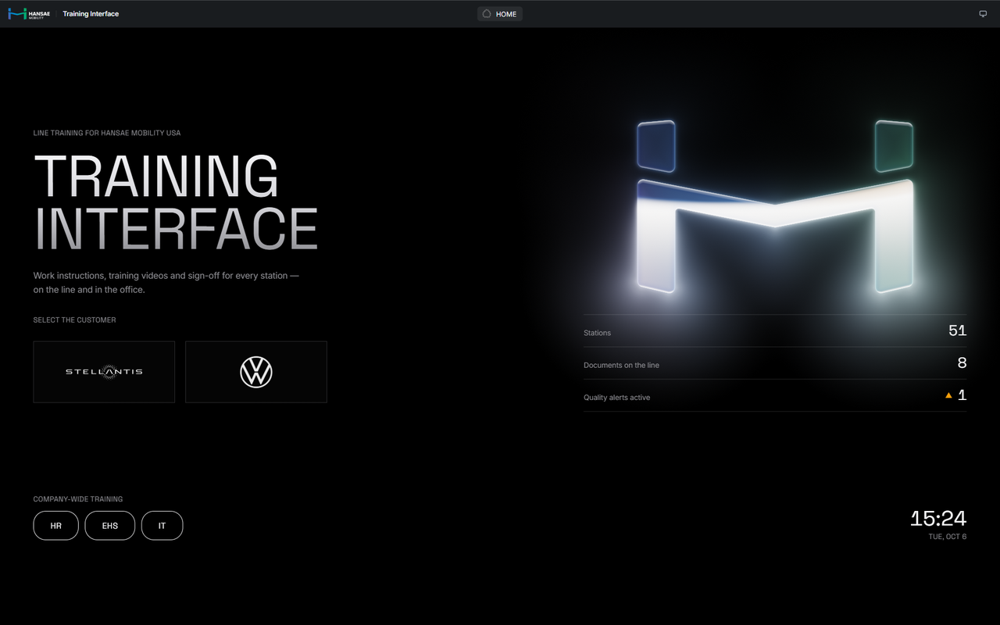

# Training Interface

A shop-floor training system for an automotive parts plant. It replaces the paper training sign-off sheet: work instructions, training videos and sign-off for every station, on the line touchscreens and in the office.

> **The source code is private.** This is client work, so only this overview is public.

## What it does

- **Line touchscreens:** pick customer → line → station and open the current work instructions, training videos (chapters and subtitles) and quality alerts
- **Sign-off:** operators sign that they read and understood the current revision; supervisors confirm in the office
- **Revision-linked records:** a new document revision flags who must re-train, and every signature is tied to the exact revision it covers
- **Audit pack:** training records ready for IATF 16949 audits
- **Office admin:** plant structure, customers with logos, document publishing (Office files converted to PDF, hidden spreadsheet sheets left out), video upload with a built-in caption editor
- **Fully offline:** one in-house server; line PCs and office PCs open it in a frameless desktop app window

## Stack

FastAPI · peewee (SQLite WAL) · Next.js static export · pywebview desktop shell · LibreOffice for document conversion · pytest (600+ tests)
